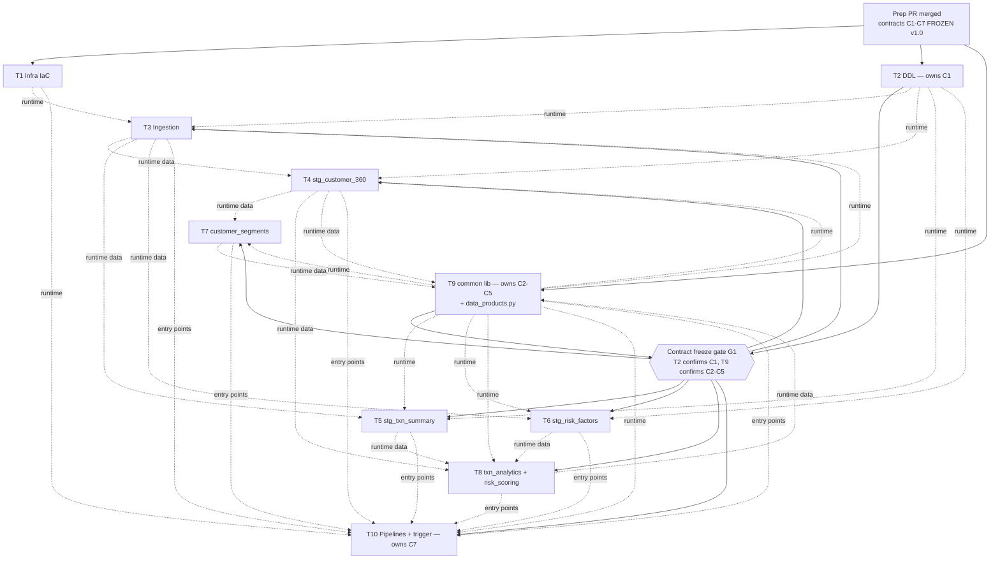

# Dispatch manifest — Teradata/SAS → Azure Synapse migration (10 tickets)

> **This is a plan for dispatch only.** The preparation task that produced this file did
> **not** start, schedule or dispatch any sessions, and none are to be started by it. Dispatch
> happens separately, after this prep PR has been reviewed and merged to `main`.

Each ticket brief (`TICKET-01.md` … `TICKET-10.md`) is self-contained: a session needs only its
brief, the repo, and the frozen contracts in `synapse/common/contracts/`.

## 1. Dependency graph

Two kinds of dependency are tracked separately:

- **Contract dependency** (needed to *write code*): satisfied by the contracts frozen in this prep PR, confirmed by T2 (C1) and T9 (C2–C5).
- **Runtime dependency** (needed for *live integration / end-to-end runs*): another ticket's implementation must be merged.

Solid arrows = must happen before the ticket starts coding. Dotted = needed only for live
integration tests and merge ordering; every ticket can be fully unit-tested locally against the
reference CSVs in `data/` before its runtime dependencies merge.

| Ticket | Contract deps (block start) | Runtime deps (block live integration / e2e) |
|---|---|---|
| T1 Infra | — | — |
| T2 DDL | — | T1 (only to deploy) |
| T9 Common + golden record | — | T2 (`ETL_RUN_LOG`, DP tables); T4, T7, T8 data for `data_products.py` e2e |
| T3 Ingestion | G1 (C1, C2, C3, C4) | T1 storage, T2 tables, T9 helper procs |
| T4 stg_customer_360 | G1 (C1, C2, C3) | T2, T9 helper procs, T3 data |
| T5 stg_txn_summary | G1 (C1, C2, C3) | T2, T9 helper procs, T3 data |
| T6 stg_risk_factors | G1 (C1, C2, C3) | T2, T9 helper procs, T3 data |
| T7 customer_segments | G1 (C1–C5) | T9 library, T4 data |
| T8 txn + risk | G1 (C1–C5) | T9 library, T4/T5/T6 data |
| T10 Orchestration | G1 (C2, C4) + C6/C7 | everything (e2e), T1 workspace |

## 2. Dispatch waves

| Wave | Tickets | When | Fully parallel within wave? |
|---|---|---|---|
| **Wave 1** | **T1, T2, T9** | immediately after the prep PR merges | **Yes** — disjoint directories, no mutual contract dependency (T2 creates `ETL_RUN_LOG` per C2, which is already frozen) |
| **Wave 2** | **T3, T4, T5, T6, T7, T8, T10** | after **gate G1**: T2 has posted "C1 v1.0 confirmed" (or merged a C1 amendment) **and** T9 has posted "C2–C5 v1.0 confirmed" (or merged amendments). Expected within the first hour of Wave 1 | **Yes** — disjoint files, all code against frozen contracts |

**Fast path:** if the reviewer of this prep PR is satisfied that C1–C5 need no amendment, G1 can be
declared at merge time and all 10 tickets dispatched at once. The waves only exist to protect
Wave 2 from a late contract change by T2/T9.

**Why T2 and T9 first:** C1 (schema) is consumed by every other ticket; C2–C5 (audit, validation,
connectivity, write-back) are consumed by every staging proc and Spark job. Freezing them first is
what makes the remaining seven tickets independent of each other.

## 3. Recommended merge order

1. **T2** (DDL) and **T9** (common library; `data_products.py` may follow in the same PR) — as early as possible; everything integrates against them.
2. **T1** (any time; independent).
3. **T3**, then **T4 / T5 / T6** (any order).
4. **T7 / T8** (any order).
5. **T10** last, then an integrator end-to-end run: merge all branches locally, run every ticket's test suite **twice** (catches port/container and module-patching order issues), then chain T3 → T4–T6 → T7 → T8 → T9 locally on the reference data.

## 4. Branches and ownership (non-overlapping)

All branches start from `main` **after** this prep PR is merged. The `migrate/` prefix is unused in
this repo (older fan-outs used `devin/*`), so branch names cannot collide with stale branches.

| Ticket | Branch | Exclusive write ownership | Local SQL Server port |
|---|---|---|---|
| T1 | `migrate/ticket-01-infra` | `synapse/infra/**`, `synapse/tests/ticket_01/**` | — |
| T2 | `migrate/ticket-02-ddl` | `synapse/sql/ddl/**`, `synapse/tests/ticket_02/**`, `synapse/common/contracts/01_schema_contract.md` | 14332 |
| T3 | `migrate/ticket-03-ingestion` | `synapse/ingestion/**`, `synapse/tests/ticket_03/**` | 14333 |
| T4 | `migrate/ticket-04-stg-customer-360` | `synapse/sql/staging/usp_stg_customer_360.sql`, `synapse/tests/ticket_04/**` | 14334 |
| T5 | `migrate/ticket-05-stg-txn-summary` | `synapse/sql/staging/usp_stg_txn_summary.sql`, `synapse/tests/ticket_05/**` | 14335 |
| T6 | `migrate/ticket-06-stg-risk-factors` | `synapse/sql/staging/usp_stg_risk_factors.sql`, `synapse/tests/ticket_06/**` | 14336 |
| T7 | `migrate/ticket-07-customer-segments` | `synapse/spark/customer_segments.py`, `synapse/tests/ticket_07/**` | — |
| T8 | `migrate/ticket-08-txn-risk-analytics` | `synapse/spark/txn_analytics.py`, `synapse/spark/risk_scoring.py`, `synapse/tests/ticket_08/**` | — |
| T9 | `migrate/ticket-09-common-golden-record` | `synapse/common/**` (except `__init__.py`, `contracts/01_*`, `contracts/06_*`, `contracts/07_*`, `contracts/README.md`, `contracts/stubs/**`), `synapse/spark/data_products.py`, `synapse/tests/ticket_09/**` | 14339 |
| T10 | `migrate/ticket-10-orchestration` | `synapse/pipelines/**`, `synapse/tests/ticket_10/**`, `synapse/common/contracts/07_entry_points_contract.md` | — |

Contract owned by T1 (`06_environment_and_naming_contract.md`) may also be amended by T1 only.

### Shared files nobody edits during the waves (integrator only)

`synapse/README.md` (incl. the ticket status table), `synapse/tickets/**`,
`synapse/common/contracts/README.md`, `synapse/common/contracts/stubs/**`,
`synapse/requirements.txt`, `synapse/requirements-dev.txt`, `synapse/.gitignore`,
`synapse/common/__init__.py`, `synapse/spark/__init__.py`, `synapse/tests/README.md`, and every
directory `README.md` *except* the one in the ticket's own directory (T1 `infra/`, T2 `sql/ddl/`,
T3 `ingestion/`, T9 `common/` + `common/sql/`, T10 `pipelines/` may replace their own placeholder).
`synapse/sql/staging/README.md` and `synapse/spark/README.md` are shared by several tickets, so
they stay integrator-only. Anything outside `synapse/` is read-only for every ticket.

### Known collision hotspots and how they are avoided

| Hotspot | Mitigation |
|---|---|
| Shared `requirements*.txt` | frozen in prep; per-ticket extras in `synapse/tests/ticket_NN/requirements.txt` |
| Package `__init__.py` files | created empty by prep; nobody edits them |
| Shared `conftest.py` | none at `synapse/tests/`; each ticket has its own under `ticket_NN/` |
| Shared SQL Server test container | one host port + container name per ticket (table above); remove only your own container |
| Fakes of `common.*` before T9 merges | live only in the ticket's own tests folder; patch both `sys.modules` and the attribute on the `common` package |
| `ETL_RUN_LOG` DDL vs. its contract | shape owned by T9 (C2), DDL written by T2 — both read the same frozen C2 §2 |
| Synapse linked services / `common.zip` packaging | owned by T10 only |
| `__pycache__` committed by mistake | `synapse/.gitignore` (prep) |

## 5. Dispatch checklist (for whoever dispatches later — not done by the prep task)

- [ ] Prep PR reviewed and merged to `main`.
- [ ] Wave 1: start one session each for T1, T2, T9 with the prompt "Execute `synapse/tickets/TICKET-NN.md` in `COG-GTM/retail-banking-analytics-pipeline`."
- [ ] Gate G1: T2 and T9 PR descriptions say contracts confirmed (or amendments merged and announced).
- [ ] Wave 2: start T3, T4, T5, T6, T7, T8, T10 the same way.
- [ ] Integrator updates the status column in `synapse/README.md` as PRs merge, then performs the end-to-end check in §3.5.
