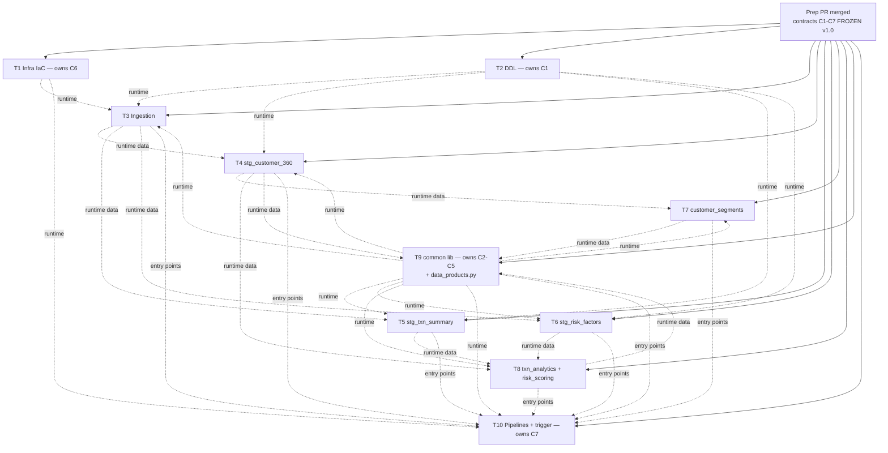

# Dispatch manifest — Teradata/SAS → Azure Synapse migration (10 tickets)

> **This is a plan for dispatch only.** The preparation task that produced this file did
> **not** start, schedule or dispatch any sessions, and none are to be started by it. Dispatch
> happens separately, after this prep PR has been reviewed and merged to `main`.

Each ticket brief (`TICKET-01.md` … `TICKET-10.md`) is self-contained: a session needs only its
brief, the repo, and the frozen contracts in `synapse/common/contracts/`.

## 1. Dependency graph

All ten tickets code against the contracts frozen by this prep PR, so **no ticket waits on another
to start**. The only dependencies left are runtime ones (needed for live integration, end-to-end
runs and merge order).

Solid arrows = must happen before the ticket starts coding (only the prep merge). Dotted = needed
only for live integration tests and merge ordering; every ticket can be fully unit-tested locally
against the reference CSVs in `data/` before its runtime dependencies merge, using stand-ins for
other tickets' objects that live only in its own `synapse/tests/ticket_NN/` folder.

| Ticket | Blocks start | Runtime deps (block live integration / e2e) |
|---|---|---|
| T1 Infra | prep merge | — |
| T2 DDL | prep merge | T1 (only to deploy) |
| T9 Common + golden record | prep merge | T2 (`ETL_RUN_LOG`, DP tables); T4, T7, T8 data for `data_products.py` e2e |
| T3 Ingestion | prep merge | T1 storage, T2 tables, T9 helper procs |
| T4 stg_customer_360 | prep merge | T2, T9 helper procs, T3 data |
| T5 stg_txn_summary | prep merge | T2, T9 helper procs, T3 data |
| T6 stg_risk_factors | prep merge | T2, T9 helper procs, T3 data |
| T7 customer_segments | prep merge | T9 library, T4 data |
| T8 txn + risk | prep merge | T9 library, T4/T5/T6 data |
| T10 Orchestration | prep merge | everything (e2e), T1 workspace |

## 2. Dispatch: one wave, all 10 tickets at once

All ten sessions start together as soon as this prep PR merges to `main`. Launch prompts are in
[`prompts/`](prompts/README.md), one per ticket.

Because consumers are coding against C1–C7 at the same moment their owners are, contracts are
**frozen for the whole wave**:

- **Owners** (T2 → C1, T9 → C2–C5, T1 → C6, T10 → C7) re-read their contracts against the
  Teradata/SAS sources first. They may commit **additive, non-breaking** amendments only
  (clarifications, new optional parameters with defaults, new columns appended at the end of a
  table that no consumer reads yet), in the first commit of their PR, called out at the top of the
  PR description. Renaming, retyping, reordering or removing anything a consumer relies on is a
  **breaking change**: code to v1.0 and raise it as a "Contract change request" for the
  integrator instead.
- **Consumers** never edit contracts; they code to v1.0 exactly and raise any problem as a
  "Contract change request" in their PR description.

## 3. Recommended merge order

1. **T2** (DDL) and **T9** (common library; `data_products.py` may follow in the same PR) — as early as possible; everything integrates against them.
2. **T1** (any time; independent).
3. **T3**, then **T4 / T5 / T6** (any order).
4. **T7 / T8** (any order).
5. **T10** last, then an integrator end-to-end run: merge all branches locally, run every ticket's test suite **twice** (catches port/container and module-patching order issues), then chain T3 → T4–T6 → T7 → T8 → T9 locally on the reference data.

## 4. Branches and ownership (non-overlapping)

All branches start from `main` **after** this prep PR is merged. The `migrate/` prefix is unused in
this repo (older fan-outs used `devin/*`), so branch names cannot collide with stale branches.

| Ticket | Branch | Exclusive write ownership | Local SQL Server port |
|---|---|---|---|
| T1 | `migrate/ticket-01-infra` | `synapse/infra/**`, `synapse/tests/ticket_01/**` | — |
| T2 | `migrate/ticket-02-ddl` | `synapse/sql/ddl/**`, `synapse/tests/ticket_02/**`, `synapse/common/contracts/01_schema_contract.md` | 14332 |
| T3 | `migrate/ticket-03-ingestion` | `synapse/ingestion/**`, `synapse/tests/ticket_03/**` | 14333 |
| T4 | `migrate/ticket-04-stg-customer-360` | `synapse/sql/staging/usp_stg_customer_360.sql`, `synapse/tests/ticket_04/**` | 14334 |
| T5 | `migrate/ticket-05-stg-txn-summary` | `synapse/sql/staging/usp_stg_txn_summary.sql`, `synapse/tests/ticket_05/**` | 14335 |
| T6 | `migrate/ticket-06-stg-risk-factors` | `synapse/sql/staging/usp_stg_risk_factors.sql`, `synapse/tests/ticket_06/**` | 14336 |
| T7 | `migrate/ticket-07-customer-segments` | `synapse/spark/customer_segments.py`, `synapse/tests/ticket_07/**` | — |
| T8 | `migrate/ticket-08-txn-risk-analytics` | `synapse/spark/txn_analytics.py`, `synapse/spark/risk_scoring.py`, `synapse/tests/ticket_08/**` | — |
| T9 | `migrate/ticket-09-common-golden-record` | `synapse/common/**` (except `__init__.py`, `contracts/01_*`, `contracts/06_*`, `contracts/07_*`, `contracts/README.md`, `contracts/stubs/**`), `synapse/spark/data_products.py`, `synapse/tests/ticket_09/**` | 14339 |
| T10 | `migrate/ticket-10-orchestration` | `synapse/pipelines/**`, `synapse/tests/ticket_10/**`, `synapse/common/contracts/07_entry_points_contract.md` | — |

Contract owned by T1 (`06_environment_and_naming_contract.md`) may also be amended by T1 only.

### Shared files nobody edits during the wave (integrator only)

`synapse/README.md` (incl. the ticket status table), `synapse/tickets/**`,
`synapse/common/contracts/README.md`, `synapse/common/contracts/stubs/**`,
`synapse/requirements.txt`, `synapse/requirements-dev.txt`, `synapse/.gitignore`,
`synapse/common/__init__.py`, `synapse/spark/__init__.py`, `synapse/tests/README.md`, and every
directory `README.md` *except* the one in the ticket's own directory (T1 `infra/`, T2 `sql/ddl/`,
T3 `ingestion/`, T9 `common/` + `common/sql/`, T10 `pipelines/` may replace their own placeholder).
`synapse/sql/staging/README.md` and `synapse/spark/README.md` are shared by several tickets, so
they stay integrator-only. Anything outside `synapse/` is read-only for every ticket.

### Known collision hotspots and how they are avoided

| Hotspot | Mitigation |
|---|---|
| Shared `requirements*.txt` | frozen in prep; per-ticket extras in `synapse/tests/ticket_NN/requirements.txt` |
| Package `__init__.py` files | created empty by prep; nobody edits them |
| Shared `conftest.py` | none at `synapse/tests/`; each ticket has its own under `ticket_NN/` |
| Shared SQL Server test container | one host port + container name per ticket (table above); remove only your own container |
| Fakes of `common.*` before T9 merges | live only in the ticket's own tests folder; patch both `sys.modules` and the attribute on the `common` package |
| `ETL_RUN_LOG` DDL vs. its contract | shape owned by T9 (C2), DDL written by T2 — both read the same frozen C2 §2 |
| Synapse linked services / `common.zip` packaging | owned by T10 only |
| `__pycache__` committed by mistake | `synapse/.gitignore` (prep) |

## 5. Dispatch checklist (for whoever dispatches later — not done by the prep task)

- [ ] Prep PR reviewed and merged to `main`.
- [ ] Start all 10 sessions at once, one per ticket, each with its prompt from [`prompts/TICKET-NN.md`](prompts/README.md).
- [ ] As PRs open: check each PR description for contract amendments (T1, T2, T9, T10) and "Contract change request" sections (everyone); the integrator decides and announces any v1.1.
- [ ] Integrator updates the status column in `synapse/README.md` as PRs merge, then performs the end-to-end check in §3.5.
